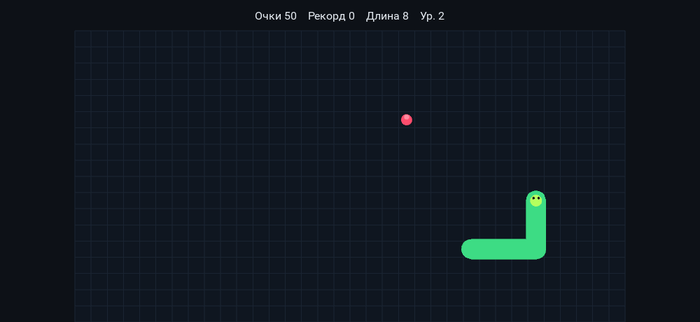

# Змейка

Одна игра в трёх оболочках: консоль, окно Windows и приложение Android.
Игровая логика одна — класс `Game` в `snake.py`; оболочки её только рисуют
и принимают ввод.

| Сборка | Файлы | Как собирается |
|--------|-------|----------------|
| Android, APK (Kivy) | `main.py`, `buildozer.spec`, `icon.png` | GitHub Actions или Linux/Docker |
| Windows, EXE (tkinter) | `snake_tk.py`, `desktop/app.py` | GitHub Actions или локально на Windows |



*Kivy-версия на десктопе в окне 1000×460 — примерно такое соотношение сторон
у телефона в горизонтальной ориентации.*

```
.
├── main.py               Android: интерфейс на Kivy (свайпы, пауза, рекорд)
├── snake.py              игровая логика, общая для всех версий
├── snake_tk.py           Windows: окно на tkinter
├── desktop/
│   ├── app.py            точка входа для сборки exe
│   ├── build.ps1         пересборка exe локально
│   ├── icon.ico          иконка приложения
│   └── README.md         детали настольной сборки
├── buildozer.spec        параметры APK: имя, иконка, ориентация, SDK/NDK
├── build.sh              сборка APK на Linux/WSL2
├── icon.png              иконка Android-приложения
└── .github/workflows/    сборка APK и EXE без своего тулчейна
```

## Запустить без сборки

```
python -m pip install "kivy==2.3.1"   # нужно только для Android-версии
python main.py                        # Kivy: свайпы, а также мышь и клавиатура
python snake_tk.py                    # окно на tkinter, зависимостей нет
```

Управление: стрелки/WASD, пробел — пауза, R — заново, Esc — выход.
На телефоне: свайп — поворот, касание — пауза/продолжить, кнопка «назад» — пауза.

## Собрать EXE для Windows

**GitHub Actions — ничего не устанавливая:** вкладка Actions → «Собрать EXE» →
Run workflow. Через пару минут забрать `zmeika-windows-exe` из Artifacts.
Workflow запускается и сам при изменениях в `snake_tk.py`, `snake.py`,
`desktop/**` или самом файле workflow.

**Локально** (Python 3.11+ и интернет для PyInstaller):

```powershell
powershell -ExecutionPolicy Bypass -File desktop\build.ps1
```

Результат — `desktop\dist\Zmeika.exe`. Exe не подписан, поэтому SmartScreen
может спросить: «Подробнее» → «Выполнить всё равно». Рекорд пишется в
`snake_highscore.txt` рядом с exe. Подробности — в `desktop/README.md`.

## Собрать APK

Buildozer (то, что превращает Python+Kivy в APK) работает только на Linux.
На Windows есть три пути — по возрастанию удобства.

### 1. Docker (проще всего на Windows)

Нужен [Docker Desktop](https://www.docker.com/products/docker-desktop/).
Из корня репозитория:

```
docker run --rm -v "%cd%":/home/user/hostcwd kivy/buildozer -v android debug
```

Готовый файл: `bin/zmeika-1.0.0-arm64-v8a_armeabi-v7a-debug.apk`.

### 2. WSL2 или Linux

```
wsl --install -d Ubuntu      # один раз, если WSL2 ещё нет
bash build.sh
```

### 3. GitHub Actions — вообще без установки тулчейна

1. Открыть Actions → «Собрать APK» → Run workflow.
2. Через 20–40 минут скачать `zmeika-debug-apk` из раздела Artifacts.

Сборка идёт в официальном образе `kivy/buildozer` (Docker), где уже стоят
JDK, Android SDK/NDK и совместимые версии buildozer и python-for-android —
поэтому результат не зависит от версий Python на раннере. Android SDK/NDK
кешируются между запусками. Запускается также при изменениях в `main.py`,
`snake.py`, `buildozer.spec`, `build.sh` или `icon.png`.

> Первая сборка всегда долгая: скачивается Android SDK + NDK (~3 ГБ) и
> компилируется Python для Android. Повторные сборки идут в разы быстрее.

## Установить на телефон

1. Перекинуть APK на телефон (кабель, облако, Telegram «себе»).
2. Открыть файл и разрешить установку из этого источника, если телефон спросит.
3. Или по кабелю с включённой отладкой: `adb install bin/*.apk`.

APK отладочный (debug), подписан отладочным ключом — для игры на своём
телефоне этого достаточно; для Google Play нужен release-ключ и
`buildozer android release`.

## Если что-то менять

- Скорость, очки, правила — в `snake.py` (класс `Game`), он общий для всех версий.
- Размер поля Android — `GameWidget._pick_grid()` в `main.py`: число клеток
  подбирается под экран (целевой размер клетки — `dp(22)`), с ограничениями
  18–34 по ширине и 10–24 по высоте.
- Цвета Android — константы `BG`, `BOARD`, `GRID`, `HEAD`, `BODY`, `FOOD`
  в `main.py`; цвета окна Windows — в `snake_tk.py`.
- Версия Kivy — `requirements` в `buildozer.spec`; версия PyInstaller —
  в `.github/workflows/build-exe.yml`.
